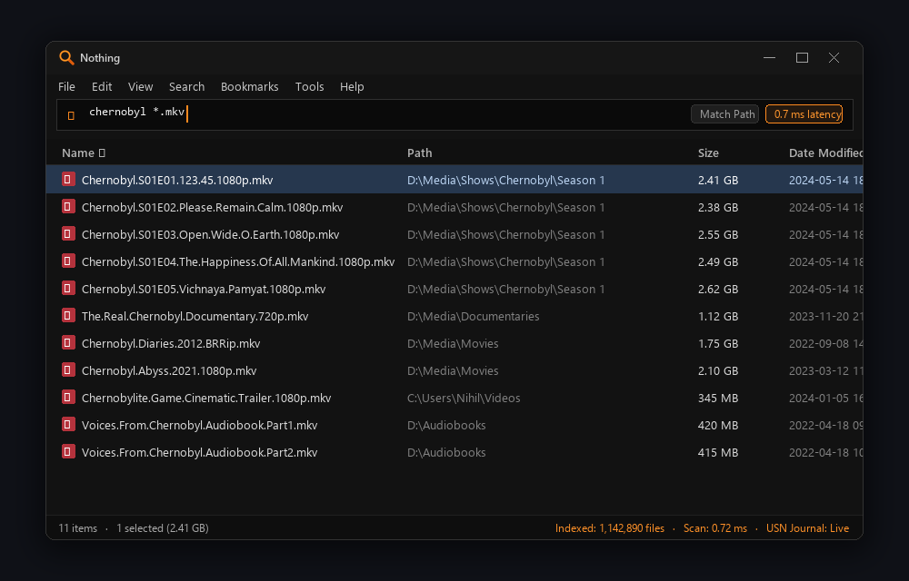
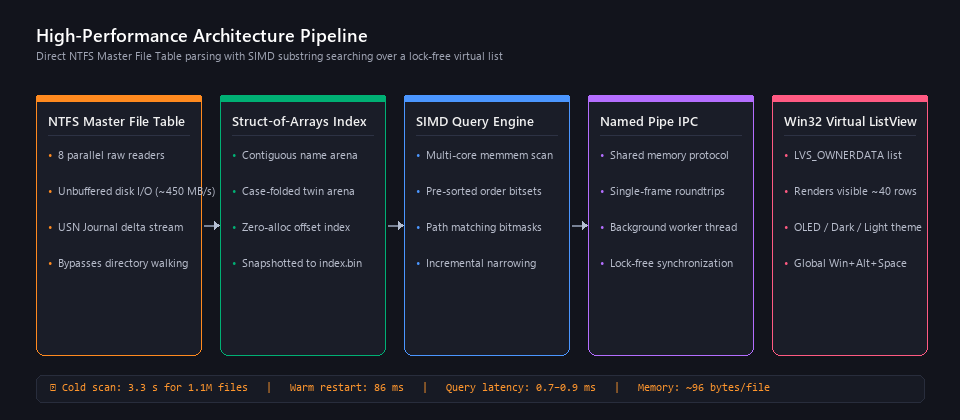

<div align="center">


# Nothing

**Instant, frame-perfect file-name search for Windows**

*In the spirit of voidtools Everything — powered by raw NTFS MFT indexing, live USN journal streaming, and multi-core SIMD memory search in Rust.*

<p>
  <a href="LICENSE"></a>
  
  
  
  
  
</p>

---

<p>
  <a href="#-about-nothing">About</a> •
  <a href="#-performance-benchmarks">Benchmarks</a> •
  <a href="#-key-features">Features</a> •
  <a href="#-visual-tour">Visual Tour</a> •
  <a href="#-search-syntax">Search Syntax</a> •
  <a href="#-keyboard-shortcuts">Shortcuts</a> •
  <a href="#-architecture--internals">Architecture</a> •
  <a href="#-installation--usage">Installation</a> •
  <a href="#-building-from-source">Building</a> •
  <a href="#-configuration">Configuration</a> •
  <a href="#-design--icon-philosophy">Design</a> •
  <a href="#-license--acknowledgments">License</a>
</p>



</div>

---

## ⚡ About Nothing

**Nothing** is a blazingly fast, lightweight desktop search utility for Windows. Type, and your results are there in the exact same frame.

Inspired by the speed and simplicity of voidtools *Everything*, Nothing is re-engineered from the ground up in modern Rust with zero runtime dependencies. It pairs a high-throughput background indexing service with an ultra-responsive native Win32 virtual list interface:

- ⚡ **Direct MFT Ingestion**: Reads the raw NTFS Master File Table (MFT) directly using 8 parallel unbuffered readers, indexing over 1.1 million files in ~3.3 seconds.
- 📡 **Live Kernel Streaming**: Tails the NTFS USN (Update Sequence Number) change journal for real-time file creation, rename, and deletion events with sub-second latency.
- 🚀 **SIMD In-Memory Search**: Searches contiguous memory arenas across all CPU cores simultaneously via SIMD `memmem` substring scanning.
- 🪟 **Pure Native Win32 UI**: Employs an owner-data virtual `ListView` (`LVS_OWNERDATA`) pulling only visible rows on demand over named-pipe IPC — never blocking the UI thread.
- 🖤 **Modern Theming & Accessibility**: Native Dark Mode, true OLED Black mode, high-DPI PerMonitorV2 support, and instant summon via <kbd>Win</kbd> + <kbd>Alt</kbd> + <kbd>Space</kbd>.

---

## 📊 Performance Benchmarks

Measured on a standard consumer PC (*Windows 11, Crucial P3 NVMe SSD, 16 threads, C: drive with 1,142,890 files*):

| Metric | Measurement | Technical Context |
|---|:---:|---|
| **Cold Drive Indexing (C:)** | **3.3 s** | 1.34 GB raw MFT parsed across 8 parallel threads (~450 MB/s disk-bound) |
| **Warm Service Restart** | **86 ms** | Instant snapshot restore (`index.bin`) + USN catch-up replay |
| **Typical Substring Query** | **0.7–0.9 ms** | Multi-term filters (`chernobyl`, `*.zip`, `mkv`) over 1.1M entries |
| **Broad & Path Queries** | **6–9 ms** | Full path traversals (`a`, `users\nihil\desktop`) with bitmask memoization |
| **Live Journal Delta** | **< 1 s** | Kernel-level event tailing for create, rename, delete, and resize |
| **Memory Footprint** | **~96 B / file** | ~100 MB RAM for 1.1 million indexed records (Struct-of-Arrays arena) |
| **Binary Footprint** | **< 1.7 MB** | Self-contained static MSVC binaries (`nothing.exe` 650 KB, `nothing-svc.exe` 540 KB) |

---

## ✨ Key Features

<table>
  <tr>
    <td width="50%">
      <h3>⚡ Instant Frame-Perfect Search</h3>
      <p>Results update keystroke-by-keystroke in the same frame. As you type, the engine narrows existing result sets dynamically without re-scanning the entire arena.</p>
    </td>
    <td width="50%">
      <h3>📂 Zero Directory Walking</h3>
      <p>Bypasses slow recursive Win32 directory APIs. Reads raw 1 KB MFT record blocks directly at disk saturation speeds (~450 MB/s).</p>
    </td>
  </tr>
  <tr>
    <td width="50%">
      <h3>🔄 Real-Time USN Journal Tailing</h3>
      <p>No periodic disk polling. Listens directly to the NTFS change journal written by the Windows kernel to catch file creations, renames, and deletions instantly.</p>
    </td>
    <td width="50%">
      <h3>🚀 Struct-of-Arrays &amp; SIMD</h3>
      <p>File names reside in contiguous byte buffers with twin case-folded arenas, allowing SIMD vector instructions to scan millions of records in sub-millisecond times.</p>
    </td>
  </tr>
  <tr>
    <td width="50%">
      <h3>🖥️ Virtual Win32 UI &amp; OLED Mode</h3>
      <p>Lightweight <code>LVS_OWNERDATA</code> virtual list loads only the ~40 visible rows. Includes Light, System, Dark, and true pitch-black OLED themes.</p>
    </td>
    <td width="50%">
      <h3>🪶 Standalone Single-File Setup</h3>
      <p>A single 1.6 MB installer deploys the Windows service, desktop client, shell hooks, auto-start tray agent, and registered uninstall handlers.</p>
    </td>
  </tr>
</table>

---

## 📸 Visual Tour

### 1. Instant Search &amp; Sub-Millisecond Filtering
Search millions of files instantly using simple tokens, boolean combinations, extensions, or full path segments.

<p align="center">
  
</p>

### 2. High-Performance Architecture Pipeline
Data flows directly from raw NTFS disk hardware through contiguous memory-mapped arenas straight to an asynchronous virtual list view.

<p align="center">
  
</p>

---

## 🔍 Search Syntax

Nothing provides an intuitive, expressive search query syntax tailored for speed:

| Operator / Filter | Example | Description |
|---|---|---|
| `AND` *(implicit)* | `project rust` | Matches items containing both `project` and `rust` in any order |
| `\|` *(OR)* | `cargo \| rustc` | Matches items containing either term (binds tighter than AND) |
| `!` *(NOT)* | `!target` or `!*.tmp` | Excludes any file or path matching the term |
| `" "` *(Quotes)* | `"Visual Studio"` | Matches exact phrases containing whitespace |
| `*` and `?` | `*.mkv`, `log_????.txt` | Wildcard matching evaluated against the entire filename |
| `\` *(Path separator)* | `users\nihil\desktop` | Automatically promotes the term to a full path match |
| `ext:` | `ext:jpg;png;webp` | Matches files with any of the specified semicolon-separated extensions |
| `file:` / `folder:` | `file:config` / `folder:src` | Restricts search to only files or only directories |
| `case:` | `case:README` | Enforces case-sensitive search for this term |
| `path:` | `path:target` | Explicitly matches the term against the complete absolute path |

> [!TIP]
> Modifiers can be stacked! For instance, `case:path:Src` will match only paths that contain `Src` with exact casing. Search settings like **Match Case** (<kbd>Ctrl</kbd> + <kbd>I</kbd>) and **Match Path** (<kbd>Ctrl</kbd> + <kbd>U</kbd>) can also be toggled globally from the menu bar.

---

## ⌨️ Keyboard Shortcuts

Designed for keyboard-first navigation with full Windows Explorer interoperability:

| Key Binding | Action |
|---|---|
| <kbd>Win</kbd> + <kbd>Alt</kbd> + <kbd>Space</kbd> | Summon or dismiss Nothing from anywhere globally |
| <kbd>Enter</kbd> | Open the selected file or execute program |
| <kbd>Ctrl</kbd> + <kbd>Enter</kbd> | Open containing folder in Windows Explorer |
| <kbd>Ctrl</kbd> + <kbd>C</kbd> | Copy selected files to Windows clipboard |
| <kbd>Ctrl</kbd> + <kbd>Shift</kbd> + <kbd>C</kbd> | Copy full file paths to clipboard as text |
| <kbd>Del</kbd> | Delete selected files (moves to Recycle Bin via Explorer dialog) |
| <kbd>Alt</kbd> + <kbd>Enter</kbd> | Open standard Windows File Properties dialog |
| <kbd>Shift</kbd> + <kbd>F10</kbd> / *Right Click* | Open native Windows Explorer context shell menu |
| <kbd>Esc</kbd> | First press clears the search bar; second press hides the window to tray |
| <kbd>F5</kbd> | Force refresh current search results and index state |
| <kbd>Tab</kbd> / <kbd>↑</kbd> / <kbd>↓</kbd> | Navigate between search bar and results list |
| *Drag & Drop* | Drag files directly from the results list into any external application |

---

## ⚙️ How It Works (Under the Hood)

Nothing achieves its extreme speed through targeted systems engineering:

- **No Directory Walking**: Standard Windows file enumeration (`FindFirstFile`/`FindNextFile`) takes 18–40 seconds to walk a 1M+ file volume. Nothing opens `\\.\C:` with elevated volume privileges, reads the raw NTFS Master File Table (MFT) using 8 concurrent unbuffered reader threads at ~450 MB/s, and streams 1 KB records directly into memory.
- **USN Journal Tailing**: After the initial index scan, Nothing continuously tails the NTFS USN Change Journal. The Windows kernel logs all filesystem mutations to this journal; Nothing catches every create, rename, delete, and resize in under a second without polling or disk thrashing.
- **Instant Snapshots**: The index is serialized directly to `%ProgramData%\Nothing\index.bin` using fast raw memory dumps. Upon machine reboot or service restart, the entire 100 MB database is loaded in ~86 ms via sequential `read_exact` calls, replaying only the journal events that occurred while offline.
- **Contiguous Struct-of-Arrays**: File names are stored in a contiguous arena alongside a case-folded twin buffer with matching byte offsets. Substring matching is executed across all available CPU cores using SIMD `memmem` search routines instead of individual per-file string allocations.
- **Zero-Cost Sorting**: Name, size, and modification date permutations are maintained incrementally in memory. A search query simply filters the pre-sorted array through a match bitset, delivering pre-sorted results instantly.
- **Path Matching Without Paths**: Folder-level answers are memoized using a fast match-crossing bitmask. Searching `users\nihil\desktop` performs a single integer bitmask lookup per file rather than building 1.1 million path strings.
- **Virtual UI Pipeline**: The user interface is built on pure Win32 using an `LVS_OWNERDATA` ListView that stores 0 items locally. It requests only the visible ~40 rows on demand from the indexing service via a high-speed local named pipe (`\\.\pipe\NothingIndex`). The UI thread never blocks or drops frames.

---

## 🚀 Installation & Usage

### Windows Installer (Recommended)

Download and run **`nothing-setup.exe`** (1.6 MB standalone installer):

```powershell
# Interactive installation (prompts for elevation once)
nothing-setup.exe

# Silent background installation
nothing-setup.exe /S
```

The installer automatically:
1. Copies `nothing.exe` and `nothing-svc.exe` into `C:\Program Files\Nothing`.
2. Registers and starts the **Nothing Index** Windows Service (`LocalSystem`, auto-start, auto-restart on failure).
3. Adds `nothing.exe --startup` to user startup (running quietly in the notification tray).
4. Registers Nothing in **Windows Settings ▸ Apps ▸ Installed apps** with clean uninstall support.

### Manual & Portable Usage

You can also run Nothing portably without the setup wrapper:
```powershell
# Install/register the indexing service
nothing.exe --install

# Uninstall and deregister the service
nothing.exe --uninstall
```

- Press <kbd>Win</kbd> + <kbd>Alt</kbd> + <kbd>Space</kbd> anywhere to summon the window.
- Closing the window minimizes it to the system tray for instantaneous re-opening.

---

## 🛠️ Building from Source

### Prerequisites
- **Windows 10 / 11 (x64)**
- **Rust stable** with the **MSVC toolchain** (`x86_64-pc-windows-msvc`)
- Administrator privileges for building the installer and interacting with raw NTFS volumes

### Repository Layout
```
crates/
├── core/   # Indexing engine, SIMD search, snapshot format, pipe protocol (pure Rust, unit tested)
├── svc/    # nothing-svc.exe: MFT reader, USN journal tailer, service host, named-pipe server
├── ui/     # nothing.exe: native Win32 window, virtual list, dark theme, Explorer shell, tray hotkey
└── setup/  # nothing-setup.exe: single-binary self-extracting installer and uninstaller
```

### Build Commands

```powershell
# 1. Clone the repository
git clone https://github.com/projectGloria/Nothing.git
cd Nothing

# 2. Compile release binaries (LTO enabled, panic=abort, static CRT)
cargo build --release

# 3. Run unit tests
cargo test

# 4. Build single-file standalone installer
.\build-installer.cmd
# Outputs -> target\release\nothing-setup.exe
```

### Developer Modes

The service binary provides useful CLI testing flags:

```powershell
# Elevated: one-shot MFT scan and query timing benchmarks
nothing-svc --scan C: --bench "chernobyl" "*.zip"

# Elevated: run the indexing engine interactively in the terminal
nothing-svc --console

# Unelevated: test directory-walking indexer serving UI without service elevation
nothing-svc --walk C:\Users\me --serve
```

---

## ⚙️ Configuration

Nothing stores user preferences in `%APPDATA%\Nothing\settings.ini`:

```ini
[window]
x=320
y=180
width=1280
height=720

[hotkey]
# Modifiers: Alt=1, Ctrl=2, Shift=4, Win=8 (Default: Win+Alt+Space)
modifiers=9
key=32

[ui]
# 0 = Use System Setting, 1 = Light, 2 = Dark, 3 = Black (OLED)
theme=2
# 0 = Details, 1 = Medium Icons, 2 = Large Icons, 3 = Extra Large Icons
view=0
```

> [!NOTE]
> Theme and View options can also be toggled directly from the **Tools ▸ Theme** and **View** application menus. Setting `NOTHING_THEME=light|dark` overrides system theme detection.

---

## 🎨 Design & Icon Philosophy

<p align="center">
  
</p>

> *"A magnifying glass whose lens is an empty ring — a zero. Nothing."*

- **The Zero Ring**: Rendered in warm orange (`#FF8A1F`), symbolizing the concept of "Nothing" — emptiness that surfaces everything instantly.
- **The Precision Handle**: Cast in deep amber (`#D95A0B`), suggesting tool-grade precision and focus.
- **Procedural Generation**: The icon is computed procedurally with 4x4 sub-pixel anti-aliasing directly at compile time (`crates/ui/res.rs`), leaving zero binary bloat in the source repository.
- **OLED & Dark Mode**: Handcrafted dark palettes (`#121212` chrome, `#0A0A0A` canvas) and true pitch-black OLED modes designed for distraction-free development environments.

---

## 📋 Scope & Current Limits (v1)

- **Filesystem**: Local NTFS volumes with assigned drive letters (C:, D:, etc.). ReFS, FAT32, exFAT, and network shares are not currently supported.
- **Folder Sizes**: Not calculated dynamically (preserves disk and CPU efficiency).
- **Access Rights**: Because the indexing service operates as `LocalSystem`, search results may list file names your user account lacks permission to read (matching standard Everything behavior).
- **Filter Syntax**: Regular expressions, `size:`, and `dm:` filters are planned for upcoming releases.

---

## 📜 License & Acknowledgments

This project is open-source software licensed under the **[MIT License](LICENSE)**.

- **Inspiration**: Immense credit to [voidtools Everything](https://www.voidtools.com/) for pioneering instant NTFS search on Windows and proving how fast desktop search can be.
- **Craftsmanship**: Built with ❤️ using modern [Rust](https://www.rust-lang.org/) and native Windows APIs.
